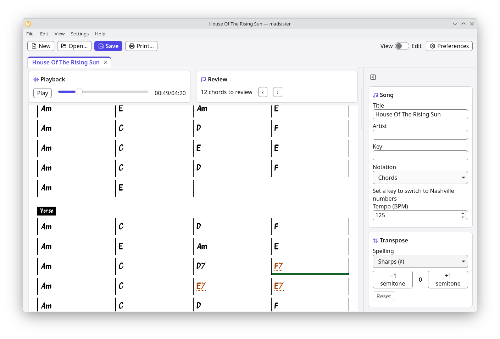
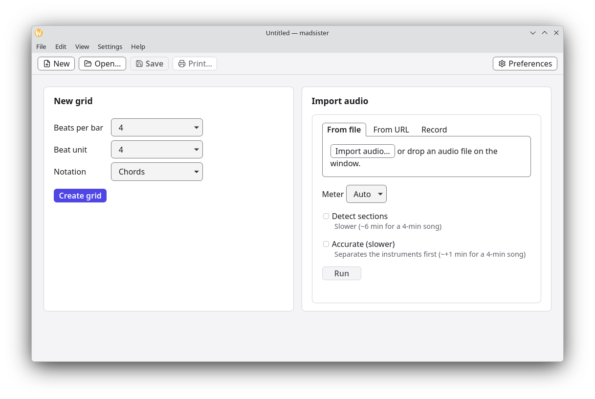

# madsister

Offline desktop app that turns a song into an editable, printable chord grid.

Give it an audio file, a URL or a recording: madsister detects the beats, the bars and the chords, and lays them out as a
musician's chart, by sections, with one or more chords per bar. Chord recognition is never perfect, so the result is a
draft: the keyboard-first editor is there to turn it into a correct chart fast, then print it or export it. Everything
runs on your machine; nothing is sent anywhere.



## Features

- Import from an audio file (or drop it on the window), a URL, or a recording; an optional accurate mode separates the
  instruments first, and optional section detection labels the intro, verses, choruses…
- Automatic beats, bars and chords. Low-confidence chords are highlighted and counted in the Review block: its arrows,
  or <kbd>F8</kbd> / <kbd>Shift</kbd>+<kbd>F8</kbd>, jump from one to the next.
- Keyboard-first grid editor, with right-click menus too; click the title, artist, key, tempo or a time signature to
  edit it. Press <kbd>?</kbd> in the app for every shortcut.
- Playback of the source audio with a cursor on the grid.
- Several songs open in tabs, reopened at the next launch; dark mode follows the system.
- Transposition, French (C7M), international (Cmaj7) or Latin (Sol7M) chord names, Nashville numbers.
- Print (with a compact two-column layout), export to ChordPro, MusicXML and MIDI; charts are saved as plain JSON files
  (`*.madsister.json`).

## Quick start



1. Import a song and click **Run** (or create an empty grid). Tick **Accurate** for better chords, at the cost of time.
2. A transcribed song opens read-only: flip the **View / Edit** switch in the toolbar to edit it.
3. Correct the chords: move with the arrow keys, type a chord, <kbd>Enter</kbd>.
4. Review the highlighted chords with <kbd>F8</kbd>, using playback (<kbd>Space</kbd>) to check by ear.
5. Print (<kbd>Ctrl</kbd>/<kbd>⌘</kbd>+<kbd>P</kbd>) or export.
6. Save (<kbd>Ctrl</kbd>/<kbd>⌘</kbd>+<kbd>S</kbd>).

Chord names, chart font, bars per row and the review threshold are in **Preferences**.

## Print many charts

`madsister print` writes each chart to a PDF (A4) next to it, as the app prints it, e.g. after an update that improves
the layout:

```sh
madsister print ~/charts/*.madsister.json
madsister print --compact --font kalam --bars-per-row 8 --out-dir ~/pdf song.madsister.json
```

- Options left out use the app's preferences: `--style fr|intl|latin`, `--font kalam|patrick-hand|petaluma-script|petaluma-text|serif`,
  `--bars-per-row 2|4|8`, `--compact` or `--no-compact`.
- It exits with 1 if a chart failed, after printing the others.
- Linux and macOS. It opens a hidden window, so it needs a desktop session. On macOS, the command is inside the app:
  `/Applications/madsister.app/Contents/MacOS/madsister print …`.

## Install (Debian, Ubuntu)

Add the apt repository once, and `apt upgrade` then keeps madsister up to date:

```sh
sudo curl -fsSLo /etc/apt/keyrings/madsister.asc https://www.dericbourg.net/madsister/key.asc
sudo tee /etc/apt/sources.list.d/madsister.sources <<'EOF'
Types: deb
URIs: https://www.dericbourg.net/madsister
Suites: stable
Components: main
Signed-By: /etc/apt/keyrings/madsister.asc
EOF
sudo apt update && sudo apt install madsister
```

- Two packages: `madsister` follows the releases; `madsister-snapshot` follows `main`, rebuilt nightly (unreleased, may be
  broken). Install either or both: the snapshot has its own command (`madsister-snapshot`), launcher and data dir, so
  it never touches the stable app's settings, and it downloads its own engine.
- amd64 only. The first launch downloads the engine (Python, its libraries and the models), once, and again after an update.
- The `.deb` and the AppImage are also on the [releases page](https://github.com/adericbourg/madsister/releases).
- Uninstall: `sudo apt remove madsister` (or `madsister-snapshot`); to remove the repository, delete
  `/etc/apt/sources.list.d/madsister.sources` and `/etc/apt/keyrings/madsister.asc`.

## Install (macOS, Apple silicon)

```sh
brew tap adericbourg/tap
brew trust --tap adericbourg/tap
brew install --cask madsister
```

- `madsister-snapshot` follows `main`, rebuilt nightly, like the apt package, and installs next to `madsister`.
- The app isn't signed or notarized: the cask clears the quarantine flag, so Gatekeeper doesn't block it. With the `.dmg`
  from the [releases page](https://github.com/adericbourg/madsister/releases), copy the app to `/Applications` and run
  `xattr -dr com.apple.quarantine /Applications/madsister.app` once.
- Same first launch as on Linux (the engine and the models download once); ffmpeg comes with the cask.
- Uninstall: `brew uninstall --cask madsister` (`--zap` also removes the engine and the data).

## Limits

- Linux (amd64) and macOS (Apple silicon) only.
- Recognition targets pop, rock, chanson and folk harmony; jazz extensions (9, 11, 13, alterations) can be typed but
  aren't detected.
- Section detection is slow (about 6 minutes for a 4-minute song) and downloads its models on first use. So does the
  accurate mode (source separation, about one more minute for a 4-minute song).
- Network access is needed only for the first launch, the first section detection or accurate transcription, and URL
  imports.

## License

madsister's code is GPLv3 ([LICENSE](LICENSE)). The engine includes madmom's CC BY-NC-SA 4.0 model weights, so the
application is for **non-commercial use only**; see [THIRD_PARTY.md](THIRD_PARTY.md).

## Contributing

To build, run, test or package madsister from source, see [CONTRIBUTING.md](CONTRIBUTING.md).
